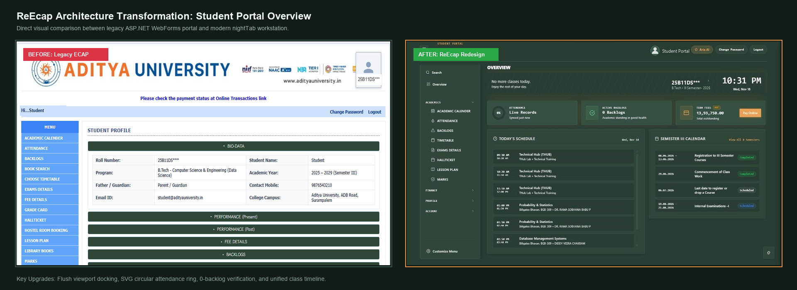
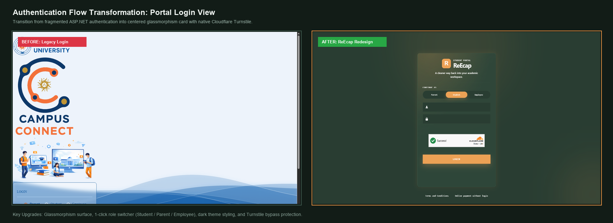
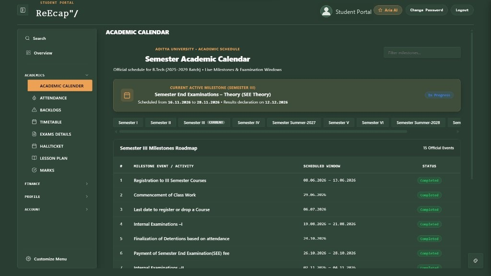

# 𝚁𝚎𝙴𝚌𝚊𝚙"/

> A modern, clean, and distraction-free academic workstation for Aditya University students (`info.aec.edu.in`).

[](https://developer.chrome.com/docs/extensions)
[]()
[](LICENSE)

**ReEcap** is a lightweight browser extension that replaces the outdated Aditya University ECAP portal with a fast, modern workstation. Everything runs 100% locally in your browser—your login, attendance records, exam results, and fee payments still go through the official university portal without any middleman or external servers.

> **Scope**: Built and optimized strictly for students. Faculty and employee workflows remain untouched on native university portals.

---

## Showcase: Before & After Transformation

### 1. Student Portal Overview (Legacy vs. Modern Redesign)
Direct visual comparison of the student workstation: transforming outdated, table-heavy 2000s WebForms with 97px margins into a sleek, full-bleed nightTab dashboard featuring a live SVG attendance dial, 0-backlog verification, transparent fee ledger, and real-time class countdowns.



---

### 2. Login & Authentication Flow (Legacy vs. Modern Redesign)
Replacing the legacy ASP.NET login form with a centered glassmorphism card featuring 1-click role selection (`Student`, `Parent`, `Employee`), dark/light theme fidelity, and native Cloudflare Turnstile verification.



---

### 3. Academic Calendar & 8-Semester Roadmap
Full batch schedule for Semesters I through VIII with instant search, countdowns, and real-time milestone status chips (`Completed`, `In Progress`, `Scheduled`).



---

## What Makes ReEcap Better?

### 1. Aria AI Academic Copilot (`Ctrl + /`)
Press `Ctrl + /` anywhere on the portal to slide out your personal AI copilot:
- **Attendance Math**: Automatically calculates how many classes you can safely skip without dropping below 75%, or how many you need to attend to recover from a shortage.
- **SGPA & Performance Advisory**: Analyzes your grade trends and helps you plan target scores.
- **Quick Navigation Chips**: 1-click jumps directly to Attendance, Marks, Academic Calendar, Fees, or Timetable.
- **Privacy First**: All personal details (name, roll number, raw marks) are completely scrubbed on your device before queries are processed.

### 2. Live Academic Telemetry
- **Real-Time Attendance**: Live SVG circular attendance ring showing verified percentage.
- **Academic Standing**: Instant verification of active backlogs and standing health.
- **Tuition Fee Ledger**: Transparent outstanding balance card with direct payment action.
- **Today's Class Schedule**: Real-time continuous timeline paired with countdown banners for upcoming sessions.

### 3. Interactive Class Timetable
- Multi-period lab and lecture blocks seamlessly merge into single unified cards.
- Hover over any class to instantly view faculty name, cabin details, and room numbers.
- Mobile-friendly single-day switcher for quick checks between classes.

### 4. 8-Semester Academic Calendar Roadmap
- Official batch schedule across Semesters I through VIII with instant search.
- Live status chips (`Completed`, `In Progress`, `Scheduled`) and countdowns to exams and key academic milestones.

### 5. Clean Dual-Pane Workspace
- **Zero Nested Scrollbars**: Smooth, independent scrolling for both the sidebar navigation and page content.
- **Organized Sidebar**: Grouped into 4 neat accordion categories (`Academics`, `Finance`, `Profile`, `Account`) with zero duplicate links.
- **Dedicated Fee Ledger**: Clean breakdown of semester fees, dues, and payment options without clutter.

### 6. Revaluation Answer-Script PDF Downloader
- Stitch multi-page scanned revaluation scripts into a clean, downloadable PDF booklet with one click.

### 7. Built-in Theming
- Ships with the high-contrast **Point** theme as default.
- Floating quick-switch theme menu to match your aesthetic.
- Changes apply instantly across the dashboard and all nested pages without reloading.

### 8. 100% Safe & Native
- **No Broken Buttons**: Preserves all ASP.NET postbacks, form submissions, fee gateways, and captcha verification.
- **No Annoying Popups**: Replaces disruptive native browser `alert()` popouts with clean in-page toast notifications.

---

## Quick Install (takes 1 minute)

Works on any Chromium browser (**Google Chrome**, **Microsoft Edge**, **Brave**, **Opera**):

1. **Download / Clone** this repository:
   ```bash
   git clone https://github.com/lupixele/ReEcap.git
   ```
   *(Or click **Code → Download ZIP** above and extract it)*.
2. In your browser, open the extensions page:
   - Chrome: `chrome://extensions/`
   - Edge: `edge://extensions/`
   - Brave: `brave://extensions/`
3. Turn on **Developer mode** (toggle in the top-right corner).
4. Click **Load unpacked** and select the `extension/` folder inside this project.
5. Go to [`https://info.aec.edu.in/aus/`](https://info.aec.edu.in/aus/) — the modernized portal activates automatically!

---

## Keyboard Shortcuts

| Shortcut | Action |
| --- | --- |
| `Ctrl + /` (or `Cmd + /`) | Open / Close Aria AI Copilot |
| `Escape` | Close Aria drawer, search palette, or dialogs |
| `Enter` | Send question to Aria |
| `Shift + Enter` | New line in Aria chat |

---

## License

Released under the **ReEcap Institutional License (RIL v1.0)** — exclusively permitted to college faculty, management, and students for personal, non-commercial educational and administrative convenience. See [LICENSE](LICENSE) for terms and institutional disclaimers.
